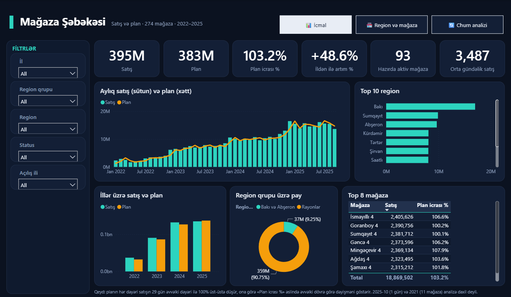
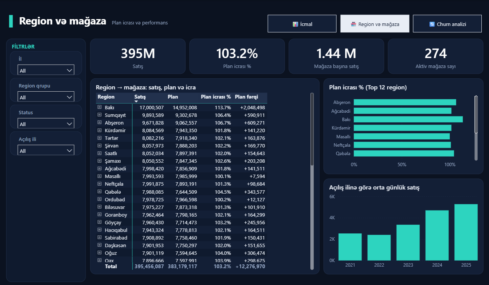
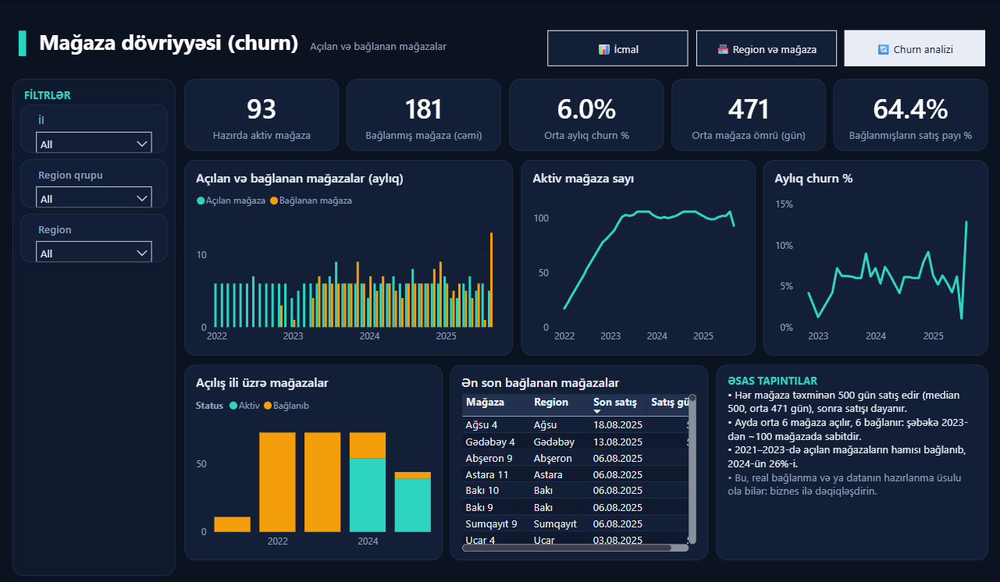
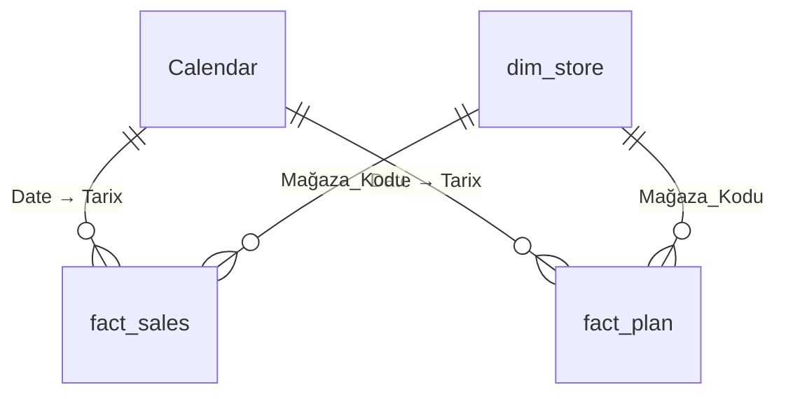

# Mağaza Şəbəkəsi: Satış, Plan və Churn Analizi

[🇬🇧 English](README.en.md) · 🇦🇿 Azərbaycanca


274 mağazalı və 50 regionlu şəbəkənin 2022–2025-ci illər üzrə gündəlik satış və plan datasının analizi. Layihə datanın təmizlənməsini (Python), ulduz sxemli modeli və 25 DAX ölçüsünü, 3 səhifəli tünd mövzulu Power BI dashboard-u və biznes nəticələrini əhatə edir.



## Layihənin məqsədi

| Sual | Cavab hansı səhifədədir |
|---|---|
| Satış necə dəyişib və plan nə qədər yerinə yetirilib? | 📊 İcmal |
| Hansı region və mağazalar önədir, hansılar geridə qalır? | 🏪 Region və mağaza |
| Mağazalar nə qədər yaşayır, şəbəkə necə yenilənir (churn)? | 🔄 Churn analizi |

## Əsas nəticələr

| Göstərici | Dəyər |
|---|---:|
| Satış (2022-01 – 2025-09) | **395.5 mln** |
| Plan | 383.2 mln |
| Plan icrası | **103.2%** |
| Satış, il-il müqayisə (2025 Yan–Sen / 2024 Yan–Sen) | **+48.6%** |
| Hazırda aktiv / bağlanmış mağaza | **93 / 181** |
| Orta aylıq churn | **6.0%** |

| İl | Satış | Plan icrası | Mağaza-gün satışı |
|---|---:|---:|---:|
| 2022 | 37.1 mln | 114.6% | 2 148 |
| 2023 | 90.7 mln | 104.8% | 2 611 |
| 2024 | 132.4 mln | 104.3% | 3 725 |
| 2025 (9 ay) | 135.2 mln | 98.5% | 5 232 |

### Müşahidələr

1. **Artım şəbəkənin böyüməsindən yox, hər mağazanın satışından gəlir.** Aktiv mağaza sayı 2023-dən təxminən 100-də sabitdir, bir mağazanın günlük satışı isə 2022-dəki 2 148-dən 2025-də 5 232-yə (+144%) yüksəlib.
2. **Plan icrası illər üzrə azalır** (114.6% → 98.5%), 2025-də 100%-in altına düşüb. Sentyabrda satış avqustdan 11.8% azdır.
3. **Bütün 50 region planı yerinə yetirir** (100.1% – 113.7%). Ən güclü region Bakıdır: 17.0 mln satış və 113.7% icra. Ardınca Sumqayıt (9.9 mln) və Abşeron (9.7 mln) gəlir.
4. **Bakı və Abşeron qrupu** (38 mağaza) 109.8% icra göstərir, rayonlar (236 mağaza) isə 102.6%.
5. **Mağaza dövriyyəsi yüksəkdir:** 274 mağazanın 181-i (66%) bağlanıb. Hər ay təxminən 5.9 mağaza açılır, 5.6 bağlanır, şəbəkə bu dövriyyə ilə yerində qalır.
6. **Mağazaların ömrü demək olar ki, sabitdir:** median 500 gün (bağlanmışlar üçün orta 471). 2021–2023-də açılan mağazaların hamısı bağlanıb, 2024-də açılanların 26%-i.
7. **Tarixi satışın 64.4%-i** sonradan bağlanan mağazalardan gəlib.

## ⚠️ Datada tapılan iki vacib məsələ

**1. Plan müstəqil hədəf deyil: satışın 29 gün gecikmiş nüsxəsidir.**
Planın hər dəyəri, mağaza və tarix üzrə, həmin mağazanın 29 gün əvvəlki satışı ilə **100.0% üst-üstə düşür** (113 829 sətrin hamısı, 28, 30 və 31 günlük gecikmələrdə uyğunluq 0%-dir). Eyni gün üçün plan ilə satış arasında korrelyasiya cəmi 0.10-dur. Bu o deməkdir ki:

- «Plan icrası %» əslində **əvvəlki ayla müqayisədə dəyişməni** göstərir, real hədəfə çatmağı yox.
- 100%-dən yuxarı icra, satışın artdığını göstərir.

Dashboard-un 1-ci səhifəsində bu barədə qeyd var. Real planlama üçün plan mağaza, mövsüm və artım trendi nəzərə alınmaqla ayrıca hazırlanmalıdır.

**2. Hər mağaza təxminən 500 gün satış edir, sonra satışı dayanır.**
Median ömür 500 gün, maksimum 529 gündür. Bu, ya real mağaza rotasiyasıdır, ya da datanın hazırlanma üsulunun (hər mağaza üçün 500 günlük pəncərə) nəticəsi ola bilər. Churn nəticələri bu qanunauyğunluğa görə şərh olunmalı və biznes tərəfi ilə dəqiqləşdirilməlidir.

## Tövsiyələr

1. **Plan qaydasını dəyişin:** mövsümilik və artımı nəzərə alan, mağaza səviyyəsində real hədəflər qurun. Ondan sonra «Plan icrası» mənalı göstəriciyə çevriləcək.
2. **500 günlük ömür qaydasını yoxlayın:** bağlanma planlıdırsa, yeni mağaza açılışlarının satışı necə sürətləndiyi (ramp-up) izlənməlidir. Plansızdırsa, səbəb araşdırılmalıdır.
3. **Mağaza başına satışa fokuslanın:** artımın mənbəyi odur. Ən yüksək mağaza-gün satışını verən mağazaların praktikaları digərlərinə tətbiq oluna bilər.
4. **2025-də icra azalmasını izləyin:** avqustdan sentyabra satış 11.8% düşüb. Bunun mövsümi olub-olmadığını 2026 datası göstərəcək.

## Dashboard səhifələri

### 📊 İcmal
Satış, plan, plan icrası, illik artım, aktiv mağaza və orta gündəlik satış kartları; aylıq satış və plan; Top 10 region; illər üzrə müqayisə; Top 8 mağaza.


### 🏪 Region və mağaza
Region → mağaza ierarxiyası (satış, plan, icra, fərq), Top 12 region üzrə plan icrası, açılış ilinə görə orta günlük satış.



### 🔄 Churn analizi
Aktiv və bağlanmış mağazalar, aylıq churn, orta mağaza ömrü, açılan və bağlanan mağazalar, açılış ili üzrə mağazalar (kohort), son bağlanan mağazalar.



## Data modeli



Ulduz sxemi (star schema): iki fakt cədvəli (`fact_sales`, `fact_plan`) eyni iki ölçü cədvəli ilə (`dim_store`, `Calendar`) bağlanıb. Beləliklə satış və plan istənilən kəsimdə (region, mağaza, ay, il) birbaşa müqayisə olunur.

### DAX ölçüləri (25)

Ölçülər `_Ölçülər` cədvəlində, qovluqlara bölünmüş şəkildə saxlanılır. Tam kodlar: [docs/DAX_measures.md](docs/DAX_measures.md)

| Qovluq | Ölçülər |
|---|---|
| **1 · Satış və Plan** | Satış, Plan, Plan icrası %, Plan fərqi, Satış payı %, Orta gündəlik satış |
| **2 · Müqayisə (zaman)** | Cari il satışı, Ötən ilin eyni dövrü satışı, İldən ilə artım %, Cari ay satışı, Ötən ay satışı, Aylıq artım %, İlin əvvəlindən satış (YTD) |
| **3 · Mağaza şəbəkəsi** | Aktiv mağaza sayı, Mağaza başına satış, Mağaza sayı |
| **4 · Churn analizi** | Hazırda aktiv mağaza, Bağlanmış mağaza, Açılan mağaza, Bağlanan mağaza, Dövrün əvvəlində aktiv mağaza, Churn %, Orta aylıq churn %, Orta mağaza ömrü, Bağlanmışların satış payı % |

Zaman müqayisələri seçimdəki **son tarixə** görə hesablanır: il seçilməyəndə də (son il, son ay) düzgün nəticə verir.

## Layihənin strukturu

```
retail-sales-vs-plan-powerbi/
├── data/
│   ├── raw/                 ← mənbə Excel faylları (repo-ya daxil deyil)
│   └── processed/           ← ETL nəticəsi: fact_sales, fact_plan, dim_store (CSV)
├── src/
│   └── etl.py               ← Excel → təmiz CSV + keyfiyyət yoxlamaları
├── powerbi/
│   ├── RetailChain.pbip     ← Power BI layihəsi (bunu açın)
│   ├── RetailChain.SemanticModel/   ← model: cədvəllər, əlaqələr, DAX (TMDL)
│   └── RetailChain.Report/          ← səhifələr və vizuallar (PBIR)
├── docs/
│   ├── DAX_measures.md
│   └── data_dictionary.md
├── images/                  ← dashboard şəkilləri
└── requirements.txt
```

## İşə salmaq

### 1. Power BI layihəsini açmaq

1. **Power BI Desktop** (Windows) quraşdırın.
2. Bu repo-nu endirin (`git clone` və ya **Code → Download ZIP**) və qısa yolda saxlayın, məsələn `C:\retail-sales-vs-plan-powerbi`. Windows-da fayl yolu 256 simvoldan uzun olarsa, Power BI vizualları oxuya bilmir.
3. `powerbi/RetailChain.pbip` faylını açın.
4. **Home → Transform data → Edit parameters → `FolderPath`**: `data\processed` qovluğunun tam yolunu yazın, sonunda `\` olsun. Məsələn: `C:\retail-sales-vs-plan-powerbi\data\processed\`
5. **Close & Apply**, sonra **Refresh**.

> Əgər `.pbip` açılmırsa: **File → Options → Preview features** bölməsində *Power BI Project (.pbip) save option*, *PBIR* və *TMDL* seçimlərini aktivləşdirin (yeni versiyalarda adətən artıq aktivdir).

### 2. ETL-i özünüz işə salmaq (istəyə bağlı)

```bash
pip install -r requirements.txt
python src/etl.py --raw "Mağaza Satış.xlsx" "Mağaza Planı.xlsx"
```

ETL `data/processed/` qovluğuna 3 CSV yazır və 5 keyfiyyət yoxlaması çap edir (dublikat yoxdur, mənfi dəyər yoxdur, kod və ad 1:1 və s.).

## Məhdudiyyətlər

- Pul vahidi datada göstərilməyib, ona görə rəqəmlər vahidsiz verilib.
- Analiz pəncərəsi 2022-01 – 2025-09-dur (2021 və 2025-10 natamam olduğu üçün çıxarılıb).
- Churn, mağazanın son satış tarixinə görə müəyyən edilir. 2025-09-dan sonra müşahidə tamamlanmadığı üçün bu aya churn hesablanmır.
- Plan datasının strukturu (satışın 29 gün gecikmiş nüsxəsi) «plan icrası» göstəricisinin şərhini məhdudlaşdırır.

## Texnologiyalar

Power BI (PBIP, TMDL, PBIR) · DAX (time intelligence, kohort və churn ölçüləri) · Power Query (M) · Python (pandas) · Star schema modelləşdirmə

## Müəllif

**Alyaz Cabbarova**: [GitHub](https://github.com/alyazcbbrv-byte) · [LinkedIn](https://www.linkedin.com/in/alyaz-cabbarova-450a6140b) · [alyazcbbrv@gmail.com](mailto:alyazcbbrv@gmail.com)

Digər layihələr: [Amazon satış analizi](https://github.com/alyazcbbrv-byte/amazon-sales-analysis) · [Toyota satış dashboard-u](https://github.com/alyazcbbrv-byte/toyota-sales-powerbi)
