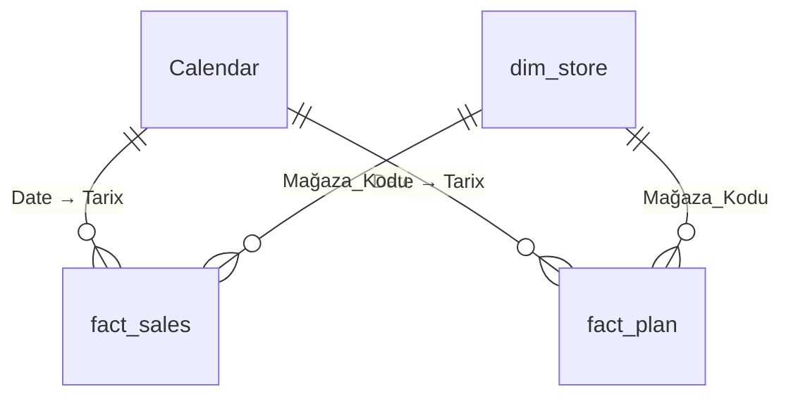

# Retail Chain: Sales, Plan and Store Churn Analysis

🇬🇧 English · [🇦🇿 Azərbaycanca](README.az.md)


Analysis of daily sales and plan data for a retail chain of **274 stores in 50 regions** (2022–2025). The project covers data cleaning in Python, a star-schema model with 25 DAX measures, a 3-page dark-theme Power BI dashboard, and the business findings.


## Business problem

| Question | Where to find the answer |
|---|---|
| How did sales change, and how much of the plan was achieved? | 📊 Overview |
| Which regions and stores lead, and which lag? | 🏪 Region and store |
| How long do stores live and how fast is the network renewed (churn)? | 🔄 Churn analysis |

## Key results

| Metric | Value |
|---|---:|
| Sales (2022-01 to 2025-09) | **395.5 M** |
| Plan | 383.2 M |
| Plan achievement | **103.2%** |
| Sales growth, 2025 Jan–Sep vs 2024 Jan–Sep | **+48.6%** |
| Active / closed stores | **93 / 181** |
| Average monthly churn | **6.0%** |

| Year | Sales | Plan achievement | Sales per store-day |
|---|---:|---:|---:|
| 2022 | 37.1 M | 114.6% | 2,148 |
| 2023 | 90.7 M | 104.8% | 2,611 |
| 2024 | 132.4 M | 104.3% | 3,725 |
| 2025 (9 months) | 135.2 M | 98.5% | 5,232 |

### Insights

1. **Growth comes from sales per store, not from a larger network.** The number of active stores has been stable at about 100 since 2023, while daily sales per store rose from 2,148 (2022) to 5,232 (2025), +144%.
2. **Plan achievement is declining** (114.6% → 98.5%) and dropped below 100% in 2025. September sales are 11.8% lower than August.
3. **All 50 regions meet the plan** (100.1% to 113.7%). Baku leads with 17.0 M in sales and 113.7% achievement, followed by Sumqayit (9.9 M) and Absheron (9.7 M).
4. **Baku and Absheron group** (38 stores) achieves 109.8%, regions (236 stores) 102.6%.
5. **Store turnover is high:** 181 of 274 stores (66%) have closed. On average about 5.9 stores open and 5.6 close every month, so the network stays flat.
6. **Store lifetime is almost fixed:** median 500 days (mean 471 for closed stores). All stores opened in 2021–2023 have closed, and 26% of those opened in 2024.
7. **64.4% of all historical sales** came from stores that later closed.

## ⚠️ Two important data findings

**1. The plan is not an independent target: it is a copy of sales lagged by 29 days.**
Every plan value matches the same store's sales from 29 days earlier **100.0% exactly** (all 113,829 rows; lags of 28, 30 and 31 days match 0%). The same-day correlation between plan and sales is only 0.10. Consequently:

- "Plan achievement %" really measures **change versus the previous month**, not progress towards a real target.
- Above 100% simply means sales are growing.

The dashboard states this in a note on page 1. A real plan should be built per store with seasonality and growth trend.

**2. Every store trades for about 500 days and then stops.**
Median lifetime is 500 days, maximum 529. This is either real store rotation or an artefact of how the data was prepared (a 500-day window per store). Churn results should be read with this in mind and confirmed with the business.

## Recommendations

1. **Change the planning method:** build store-level targets that include seasonality and growth. Only then does "plan achievement" become meaningful.
2. **Validate the 500-day lifetime rule:** if closures are planned, track how quickly new stores ramp up; if not, investigate the cause.
3. **Focus on sales per store:** it is the source of growth. Practices of the top stores by daily sales can be replicated.
4. **Watch the 2025 slowdown:** sales fell 11.8% from August to September. 2026 data will show whether it is seasonal.

## Dashboard pages

### 📊 Overview
Cards for sales, plan, plan achievement, YoY growth, active stores and average daily sales; monthly sales vs plan; Top 10 regions; yearly comparison; Top 8 stores.


### 🏪 Region and store
Region → store hierarchy (sales, plan, achievement, variance), plan achievement for the Top 12 regions, average daily sales by opening year.


### 🔄 Churn analysis
Active and closed stores, monthly churn, average store lifetime, stores opened and closed per month, stores by opening year (cohort), recently closed stores.


## Data model



A star schema: two fact tables (`fact_sales`, `fact_plan`) share two dimensions (`dim_store`, `Calendar`), so sales and plan can be compared at any level (region, store, month, year).

### DAX measures (25)

Measures live in the `_Ölçülər` table, grouped into display folders. Full code: [docs/DAX_measures.md](docs/DAX_measures.md)

| Folder | Measures |
|---|---|
| **1 · Sales and plan** | Sales, Plan, Plan achievement %, Variance, Share %, Average daily sales |
| **2 · Time comparison** | Current year, Same period last year, YoY %, Current month, Previous month, MoM %, YTD |
| **3 · Store network** | Active stores, Sales per store, Store count |
| **4 · Churn** | Currently active, Closed (total), Opened, Closed in period, Active at period start, Churn %, Average monthly churn %, Average store lifetime, Share of sales from closed stores |

Time comparisons use the **latest date in the selection**, so they work correctly even when no year is selected.

## Project structure

```
retail-sales-vs-plan-powerbi/
├── data/
│   ├── raw/                 ← source Excel files (not in the repo)
│   └── processed/           ← ETL output: fact_sales, fact_plan, dim_store (CSV)
├── src/
│   └── etl.py               ← Excel → clean CSV + data-quality checks
├── powerbi/
│   ├── RetailChain.pbip     ← Power BI project (open this)
│   ├── RetailChain.SemanticModel/   ← model: tables, relationships, DAX (TMDL)
│   └── RetailChain.Report/          ← pages and visuals (PBIR)
├── docs/
│   ├── DAX_measures.md
│   └── data_dictionary.md
├── images/                  ← dashboard screenshots
└── requirements.txt
```

## How to run

### 1. Open the Power BI project

1. Install **Power BI Desktop** (Windows).
2. Download this repo (`git clone` or **Code → Download ZIP**) into a **short path**, for example `C:\retail-sales-vs-plan-powerbi`. Windows paths longer than 256 characters stop Power BI from reading the visuals.
3. Open `powerbi/RetailChain.pbip`.
4. **Home → Transform data → Edit parameters → `FolderPath`**: enter the full path of the `data\processed` folder with a trailing `\`, e.g. `C:\retail-sales-vs-plan-powerbi\data\processed\`
5. **Close & Apply**, then **Refresh**.

> If the `.pbip` does not open: enable *Power BI Project (.pbip) save option*, *PBIR* and *TMDL* under **File → Options → Preview features** (usually already on in recent versions).

### 2. Run the ETL yourself (optional)

```bash
pip install -r requirements.txt
python src/etl.py --raw "Mağaza Satış.xlsx" "Mağaza Planı.xlsx"
```

The ETL writes three CSVs to `data/processed/` and prints five data-quality checks (no duplicates, no negative values, code-to-name 1:1, and so on).

## Limitations

- The currency is not stated in the data, so figures are given without units.
- The analysis window is 2022-01 to 2025-09 (2021 and 2025-10 are incomplete and excluded).
- Churn is based on each store's last sale date; it is not calculated after 2025-08 because observation is incomplete.
- The structure of the plan data (a 29-day lagged copy of sales) limits how "plan achievement" can be interpreted.

## Skills demonstrated

Power BI (PBIP, TMDL, PBIR) · DAX (time intelligence, cohort and churn measures) · Power Query (M) · Python (pandas) · star-schema modelling · data-quality investigation · business storytelling and recommendations

## Author

**Alyaz Cabbarova**: [GitHub](https://github.com/alyazcbbrv-byte)

More projects: [Amazon sales analysis](https://github.com/alyazcbbrv-byte/amazon-sales-analysis) · [Toyota sales dashboard](https://github.com/alyazcbbrv-byte/toyota-sales-powerbi)

## License

[MIT](LICENSE) for the code and report. The processed CSV files come from educational sample data of a training course.
